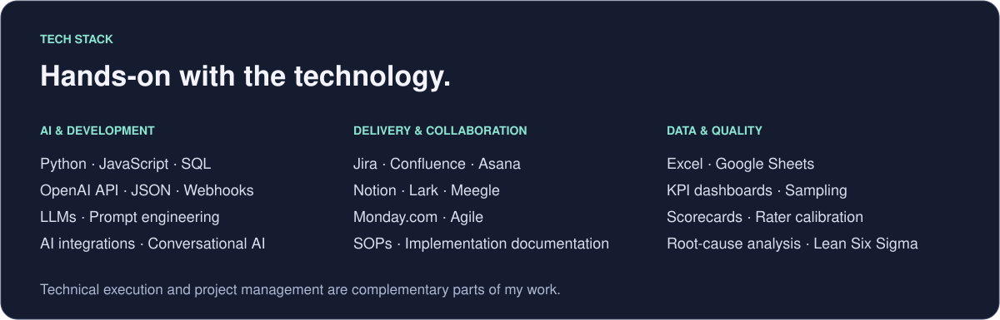
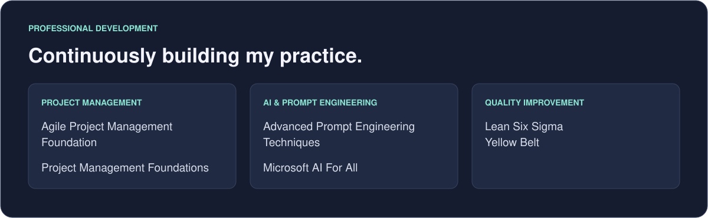

  

  <a href="#about-me">About Me</a> &nbsp; · &nbsp;
  <a href="#experience">Experience</a> &nbsp; · &nbsp;
  <a href="#tech-stack">Tech Stack</a> &nbsp; · &nbsp;
  <a href="#projects">Projects</a> &nbsp; · &nbsp;
  <a href="#connect">Connect</a>

## About Me

 

 

## Experience

## Tech Stack

## Projects

A selection of my public code and learning repositories. These are forks and course projects; my professional enterprise work is described above.

- **[JavaScript AI App · React & OpenAI API](https://github.com/elleamyr/build-a-javascript-ai-app-with-react-and-the-openai-api-4467357)** — LinkedIn Learning course repository fork.
- **[Special Topic: Data Engineering](https://github.com/elleamyr/special-topic-data-engineering)** — Coursework repository fork covering data engineering topics.
- **[Explore all repositories ↗](https://github.com/elleamyr?tab=repositories)**

## Connect

I’m interested in opportunities across AI project management, AICX, conversational AI and AI/LLM operations, including remote, full-time contract roles.

  <a href="https://www.linkedin.com/in/elinsyiraah/"><strong>Connect on LinkedIn ↗</strong></a>
  &nbsp; · &nbsp;
  <a href="https://github.com/elleamyr?tab=repositories">Explore my code ↗</a>
    
  Kuala Lumpur, Malaysia

