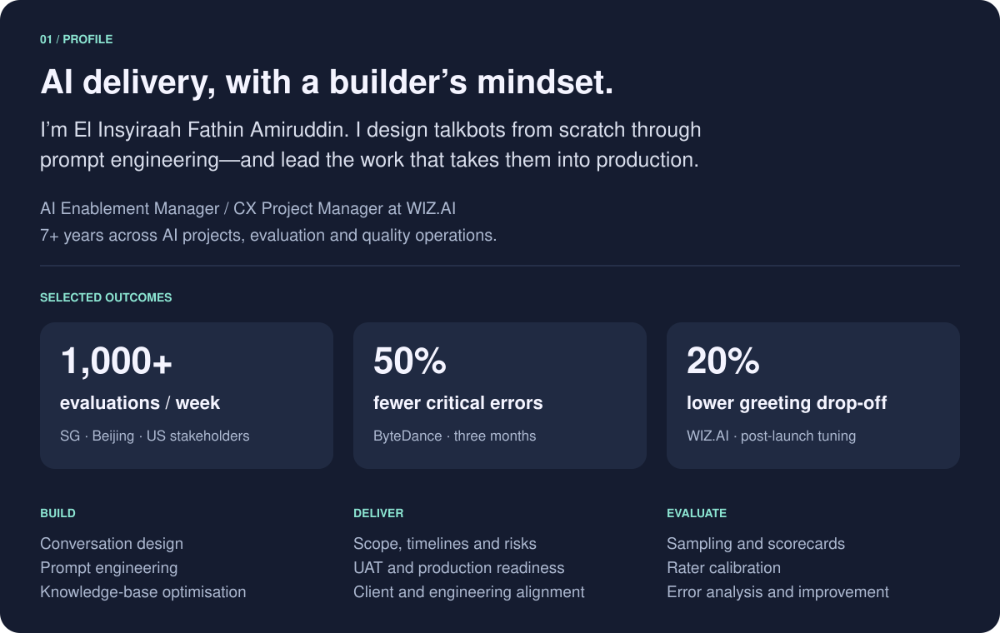
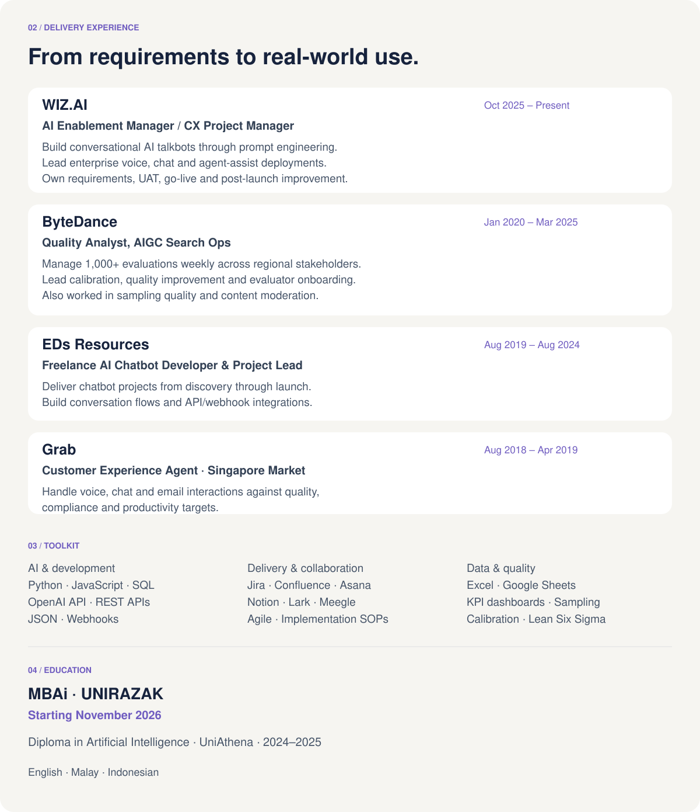

 

 

 

 

<strong>Let’s turn a promising AI idea into something people can use.</strong>  Open to remote, full-time contract opportunities.  <a href="https://www.linkedin.com/in/elinsyiraah/">Start a conversation on LinkedIn ↗</a>

