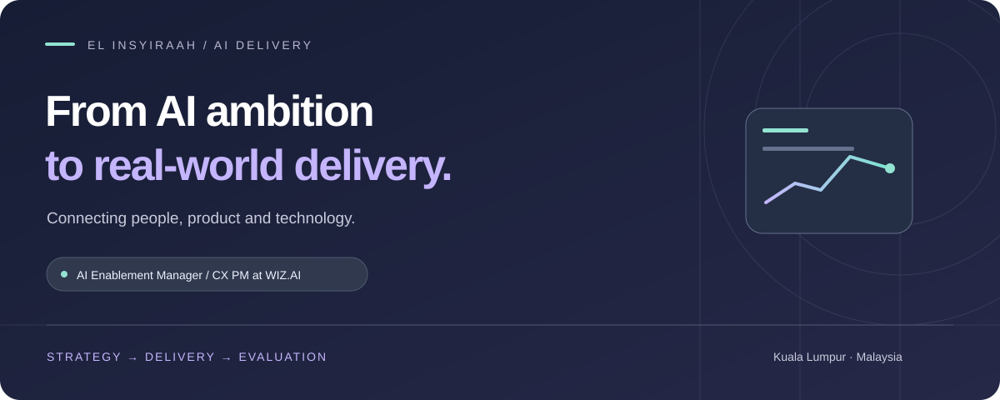
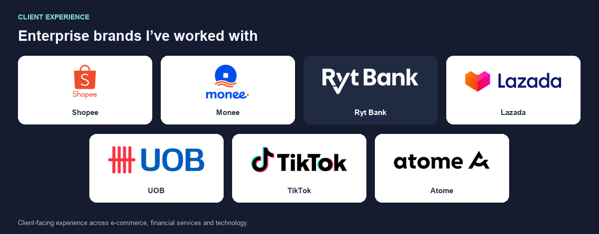
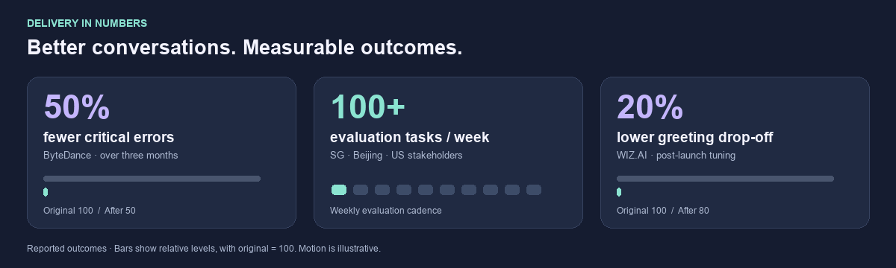
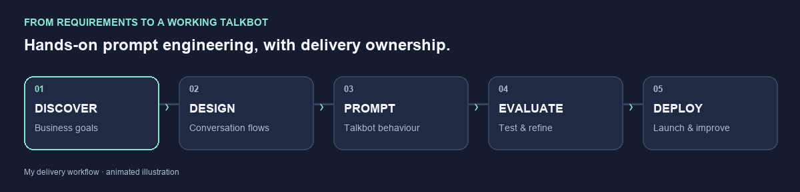

<a href="#about">About</a> · <a href="#clients">Client experience</a> · <a href="#expertise">Expertise</a> · <a href="#experience">Experience</a> · <a href="https://www.linkedin.com/in/elinsyiraah/">Connect ↗</a>

<h2 id="about">I build the talkbot. I lead the delivery.</h2>

I’m **El Insyiraah Fathin Amiruddin**, an AI Enablement Manager / CX Project Manager at **WIZ.AI**, based in Kuala Lumpur. I combine **hands-on prompt engineering** with enterprise delivery, stakeholder leadership and AI evaluation.

**I design conversational AI talkbots from scratch using prompt engineering**—translating client requirements into conversation flows and refining bot behaviour through testing and iteration. I also own the delivery work that brings those solutions into production: scope, timelines, risks, UAT, go-live and post-launch improvement.

My background spans **7+ years across AI projects, evaluation and quality operations**, including five years at ByteDance.

 

<h2 id="clients">Client experience</h2>

 

## Outcomes that matter

 

<h2 id="expertise">Where technical depth meets delivery</h2>

<table width="100%">
<tr><th width="33%">01 · BUILD</th><th width="33%">02 · DELIVER</th><th width="33%">03 · EVALUATE</th></tr>
<tr><td valign="top"><h3>Prompt engineering</h3>Talkbots built from scratch. Business requirements translated into conversation flows, prompts and expected bot behaviour.  <strong>Conversation design · Prompt iteration · Knowledge-base optimisation</strong></td><td valign="top"><h3>Enterprise AI delivery</h3>Client workshops, acceptance criteria and cross-functional coordination from discovery to launch.  <strong>Scope · Timelines · RAID · UAT · Go-live</strong></td><td valign="top"><h3>AI quality & evaluation</h3>Structured evaluation programmes, consistent rating practices and actionable feedback loops.  <strong>Scorecards · Sampling · Calibration · Root-cause analysis</strong></td></tr>
</table>

 

### Built from scratch: conversational AI talkbots

| What I do | How it creates value |
| :--- | :--- |
| **Turn client requirements into conversation designs** | Connect business goals with intended user journeys and acceptance criteria. |
| **Build talkbot behaviour through prompt engineering** | Shape how the bot responds and moves a conversation forward. |
| **Test outputs and iterate on prompts, intents and knowledge bases** | Find gaps before launch and improve behaviour after deployment. |
| **Coordinate technical and client stakeholders** | Resolve dependencies, manage risks and prepare teams for handover. |

 

<h2 id="experience">Experience & delivery ownership</h2>

| Period | Role | Selected contribution |
| :--- | :--- | :--- |
| **Oct 2025 – Present** | **WIZ.AI** AI Enablement Manager / CX Project Manager | Lead concurrent voice bot, chatbot and agent-assist deployments. Build talkbots through prompt engineering; own requirements, UAT, launch and production tuning. |
| **Jan 2020 – Mar 2025** | **ByteDance** Quality Analyst, AIGC Search Ops Also sampling quality and content moderation | Run evaluation cycles of 100+ tasks per week. Lead calibration, quality improvement, onboarding and QA apprenticeship initiatives. |
| **Aug 2019 – Aug 2024** | **EDs Resources · Freelance** AI Chatbot Developer & Project Lead | Deliver chatbot projects from discovery through build, testing, launch and support, including API/webhook integrations. |
| **Aug 2018 – Apr 2019** | **Grab** Customer Experience Agent, Singapore Market | Handle voice, chat and email interactions against quality, compliance and productivity targets. |

 

## My working toolkit

| AI & development | Delivery & collaboration | Data & improvement |
| :--- | :--- | :--- |
| Prompt engineering · Conversation design · OpenAI API | Jira · Confluence · Asana · Notion | Excel · Google Sheets · KPI dashboards |
| Python · JavaScript · SQL | Lark · Meegle · Monday.com | Root-cause analysis · Lean Six Sigma |
| REST APIs · JSON · Webhooks | Agile · SOPs · Implementation documentation | Sampling · Scorecards · Rater calibration |

<strong>Education, certifications & languages</strong>

- **Bachelor of Computer Science (Software Engineering)** · Universiti Teknologi Malaysia · 2023–Present
- **Diploma in Artificial Intelligence** · UniAthena · 2024–2025
- Agile Project Management Foundation · Project Management Foundations · Lean Six Sigma Yellow Belt · Advanced Prompt Engineering Techniques · Microsoft AI For All
- English (professional) · Malay (native) · Indonesian (conversational)

 

---

<h2>From the first prompt to production.</h2>

Hands-on AI building. Clear delivery ownership. Continuous evaluation.

<strong>Open to remote, full-time contract opportunities.</strong>

<a href="https://www.linkedin.com/in/elinsyiraah/"><strong>Let’s connect on LinkedIn ↗</strong></a>

Kuala Lumpur, Malaysia

